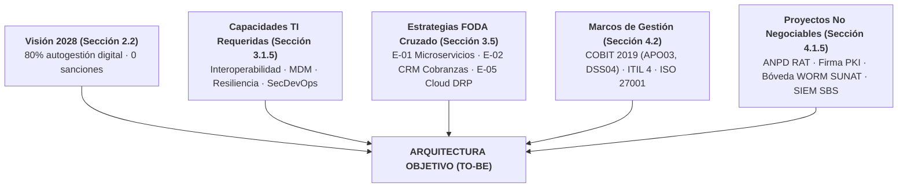
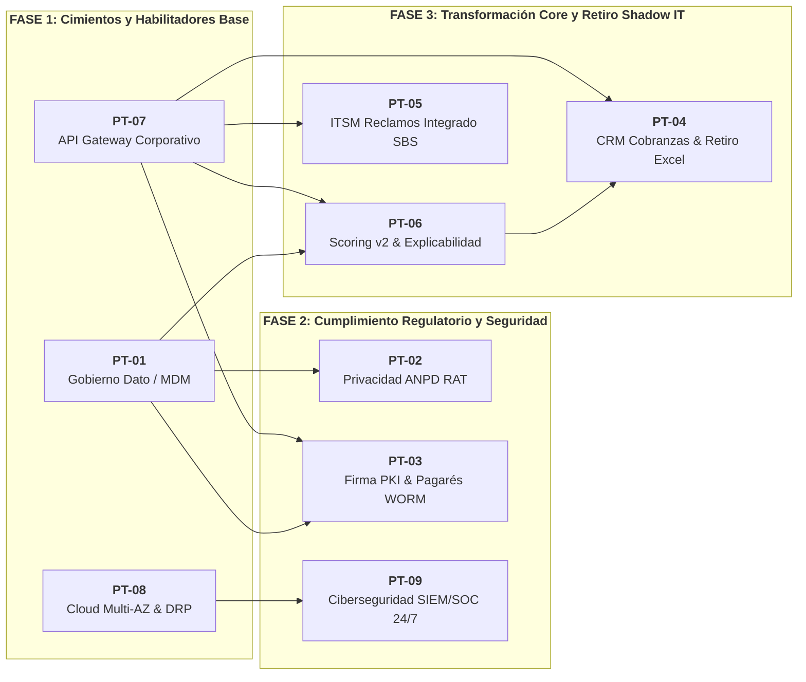

# Sección 5: Arquitectura Empresarial (PETI 2026–2028)
## Organización: CrediTech Perú S.A.C. | RUC: 20608945123
### Estudiante: Ramos Atahuachi, Fabricio Farid Edmilson (Código: 2023076798)
**Asignatura:** Planeamiento Estratégico de TI (SI-886) · **Semestre:** 2026-II  
**Docente:** Dr. Oscar Juan Jimenez Flores · Universidad Privada de Tacna

---

## 5.1 Principios de arquitectura

Los principios de arquitectura empresarial establecen las reglas normativas y directrices estratégicas que guían el diseño, la adquisición, el desarrollo y la evolución de los activos de tecnologías de información y comunicación en **CrediTech Perú S.A.C.** Formulados bajo los lineamientos del estándar **TOGAF 10th Edition** y alineados con el marco **COBIT 2019 (objetivo de gobierno APO03 Managed Enterprise Architecture)**, estos principios garantizan que cada inversión tecnológica contribuya directamente a la misión institucional y previenen la aparición de soluciones aisladas, deuda técnica incontrolada y riesgos de cumplimiento regulatorio.

### Matriz de Principios de Arquitectura

| N.° | Nombre del Principio | Declaración | Razón de Negocio y Técnica | Implicancias Operativas y de Proyecto | Trazabilidad Estratégica |
|:---:|---|---|---|---|---|
| **PR-01** | **Dato único con fuente autoritativa y dueño designado** | Cada entidad de negocio fundamental (cliente, crédito, pagaré, mora, colaborador) reside en una única fuente autoritativa oficial y cuenta con un único dueño de dato (*Data Owner*) designado formalmente por cargo gerencial. | Las decisiones comerciales y de evaluación de riesgo crediticio se toman hoy sobre cifras discrepantes entre el Core de Créditos, el Portal Web, el ERP contable y múltiples hojas de cálculo operativas (detectándose más de 68,000 registros divergentes de clientes y saldos desfasados). Esta dispersión imposibilita el cálculo certero de mora y genera fricciones en auditoría. | 1. Queda terminantemente prohibida la creación de bases de datos locales, réplicas no controladas o silos departamentales de entidades ya existentes.<br/>2. Todo aplicativo o servicio que consuma una entidad debe hacerlo conectándose a su fuente autoritativa mediante la capa de integración de servicios (APIs).<br/>3. Antes de financiar proyectos analíticos avanzados (Machine Learning v2), es condición obligatoria ejecutar el proyecto de Gobierno del Dato y Maestro de Clientes (MDM). | Deriva del diagnóstico de la Sección 3.1.3 (ventaja competitiva no capturada por inconsistencia de datos maestros), del hallazgo del taller de normatividad (Sección 4.1) y de la dinámica de modelado de la Semana 10. |
| **PR-02** | **Integración desacoplada mediante APIs y servicios seguros** | Toda comunicación e intercambio de información entre componentes de software, tanto internos como con proveedores externos (burós crediticios, pasarelas de pago, SUNAT, RENIEC), debe realizarse exclusivamente a través de interfaces de programación (APIs RESTful seguras, estandarizadas y documentadas bajo OpenAPI), erradicando las transferencias mediante archivos planos o accesos directos a bases de datos. | La sincronización actual entre el Core de Créditos y el sistema contable/financiero se ejecuta mediante scripts nocturnos por lotes (*batch*) y transferencias manuales de archivos CSV. Este mecanismo genera desfasajes temporales de hasta 24 horas, bloqueos por fallos de formato, reprocesos manuales recurrentes e incapacidad de consultar el saldo en tiempo real. | 1. Se debe desplegar una capa corporativa de gestión de APIs (*API Gateway*) con políticas homogéneas de autenticación (OAuth 2.0 / mTLS), cuotas de consumo (*rate limiting*) y telemetría.<br/>2. Ningún proyecto de software podrá consultar o modificar directamente las tablas de base de datos de otro componente.<br/>3. Los contratos de integración con proveedores de servicios externos deberán exigir interfaces síncronas o webhooks con cifrado TLS 1.3. | Deriva de la Resolución SBS N.° 504-2021 (Art. 20, seguridad en desarrollo e integraciones), de la capacidad requerida de interoperabilidad (Sección 3.1.5) y de la Estrategia E-01 del FODA cruzado (Sección 3.5). |
| **PR-03** | **Automatización end-to-end y erradicación del Shadow IT** | Los procesos misionales de la cadena de valor crediticia deben operar sobre sistemas corporativos auditables y homologados, prohibiéndose terminantemente el uso de hojas de cálculo o herramientas ofimáticas personales para tareas operativas de ruteo, scoring manual o asignación de cobranzas. | Procesos de alto impacto financiero como la asignación de cartera en mora y la reevaluación de créditos observados operan hoy sobre libros compartidos de Microsoft Excel. Esta práctica expone a la organización a corrupción de datos, fórmulas alteradas sin control de versiones, fuga de información confidencial de deudores y carencia absoluta de pistas de auditoría. | 1. La funcionalidad de ruteo y gestión de cobranzas debe integrarse nativamente en una plataforma CRM/BPM corporativa auditada.<br/>2. Las reglas de negocio de evaluación crediticia deben residir en motores de reglas o servicios analíticos versionados en Git, no en celdas de cálculo.<br/>3. La Dirección de TI auditará trimestralmente las estaciones de trabajo para asegurar el desmantelamiento de repositorios informales de datos. | Deriva del diagnóstico de debilidad operacional (Sección 3.1.2), de la Resolución SBS N.° 11356-2008 (control del riesgo operacional en procesos críticos) y del mandato de retiro de Shadow IT de la Sección 3.5 (Estrategia E-02). |
| **PR-04** | **Privacidad, seguridad y cumplimiento normativo por diseño y por defecto** | Toda solución tecnológica, arquitectura de software, infraestructura y base de datos debe incorporar controles de seguridad de la información, cifrado de datos en reposo y en tránsito, y respeto estricto a los derechos ARCO de los titulares desde su concepción inicial y no como una capa añadida a posteriori. | CrediTech procesa datos biométricos faciales, historial crediticio y transacciones económicas sensibles de más de 210,000 ciudadanos. La auditoría previa de la Sección 4.1 reveló una tasa de incumplimiento del 50% en exigencias de la SBS y ANPD, exponiendo a la empresa a sanciones de hasta 100 UIT y revocación de habilitación operativa. | 1. Es obligatorio el modelado de amenazas y la ejecución automatizada de análisis estático/dinámico de código (SAST/DAST) en el pipeline de despliegue antes de cualquier liberación a producción.<br/>2. Todos los repositorios de datos que contengan datos personales sensibles deben cifrarse con AES-256 en reposo y TLS 1.3 en tránsito.<br/>3. Todo flujo de usuario debe capturar consentimiento explícito e inequívoco y registrarlo en una pista de auditoría inmutable (SIEM/SOC). | Deriva de la Ley N.° 29733 y D.S. 016-2024-JUS (Protección de Datos Personales), de la Resolución SBS N.° 504-2021 (Reglamento de Seguridad y Ciberseguridad) y de los Proyectos No Negociables de la Sección 4.1.5. |
| **PR-05** | **Resiliencia, alta disponibilidad e inmutabilidad de la infraestructura** | La infraestructura tecnológica de soporte a los servicios misionales debe diseñarse para tolerar contingencias mayores sin interrupción del negocio (RTO ≤ 1 hora, RPO ≤ 15 minutos), con arquitecturas distribuidas multizona en la nube y mecanismos de respaldo inmutables protegidos contra ransomware. | La organización mantiene servidores físicos locales sin redundancia para contabilidad y un despliegue en la nube en una única zona de disponibilidad (Single-AZ) sin conmutación automática de contingencia probada. Un incidente de ransomware o caída de infraestructura provocaría la paralización de la colocación de créditos y la cobranza por tiempo indeterminado. | 1. Desmantelamiento de servidores físicos locales y migración de cargas transaccionales a arquitecturas contenerizadas en la nube con balanceo de carga multizona (Multi-AZ).<br/>2. Implementación de políticas de inmutabilidad documental (*WORM - Write Once, Read Many*) mediante AWS S3 Object Lock para pagarés electrónicos y facturas tributarias.<br/>3. Realización obligatoria de dos simulacros anuales de recuperación ante desastres (DRP) con verificación formal de tiempos de recuperación. | Deriva de la Resolución SBS N.° 504-2021 (Art. 27, Plan de Continuidad Tecnológica), del marco COBIT 2019 (objetivo DSS04 Managed Continuity) y de los compromisos de disponibilidad de la Sección 4.3. |
| **PR-06** | **Autoservicio omnicanal con explicabilidad algorítmica** | Los canales digitales (portal web, aplicativo móvil, bots de mensajería) deben brindar una experiencia de autoservicio continuo 24/7 al solicitante de crédito, garantizando transparencia en las decisiones crediticias mediante modelos de scoring explicables y opción de atención asistida por un asesor humano. | El 68% de las solicitudes rechazadas por el motor analítico provocan abandono y reclamos formales debido a mensajes genéricos opacos («Su crédito no califica»), lo cual incumple el marco de conducta de mercado SBS y erosiona la lealtad de la cartera de clientes. | 1. La arquitectura de canales debe exponer interfaces de usuario claras que desglosen de manera entendible los factores objetivos determinantes de la calificación de riesgo.<br/>2. El sistema debe incorporar un botón directo para que el usuario pueda apelar el dictamen algorítmico y solicitar revisión humana asistida en un plazo máximo de 24 horas.<br/>3. El motor de scoring debe proporcionar coeficientes de explicabilidad (SHAP values / LIME) en cada inferencia registrada. | Deriva de la Visión institucional de la Sección 2.2 («80% de créditos autogestionados por canal digital»), de la Resolución SBS N.° 3198-2023 (Art. 15 y 18, conducta de mercado y no discriminación) y de la Estrategia E-03. |

---

## 5.2 Arquitectura actual (As-Is)

La arquitectura actual de CrediTech Perú S.A.C. responde a un modelo de crecimiento orgánico y reactivo, típico de empresas del sector *Fintech* en fase de rápida expansión donde la agilidad comercial inicial primó sobre el diseño estructurado. Esto ha originado una deuda arquitectónica crítica evidenciada en fragmentación de datos, integraciones precarias y la dependencia de hojas de cálculo (*Shadow IT*) para sostener la operación diaria.

### 5.2.1 Capa de Negocio: Actores, Procesos y Servicios
- **Actores de Negocio:**
  - *Cliente / Solicitante de Microcrédito:* Persona natural o microempresario que interactúa por canales digitales o presenciales para solicitar financiamiento de corto plazo.
  - *Asesor Comercial Digital:* Colaborador de ventas responsable de la captación asistida, seguimiento de prospectos y asesoría inicial.
  - *Analista de Operaciones y Créditos:* Responsable de supervisar las evaluaciones observadas, validar expedientes crediticios y aprobar excepciones operativas.
  - *Gestor de Cobranzas y Tramo de Mora:* Colaborador asignado a la gestión preventiva de cuotas por vencer y la recuperación prejudicial de saldos vencidos.
  - *Analista de Tesorería y Finanzas:* Responsable de la ejecución manual de transferencias interbancarias, fondeo y conciliación de extractos.
  - *Oficial de Cumplimiento / CISO:* Responsable del control normativo PLAFT, la supervisión de protección de datos personales y la seguridad de la información.
- **Procesos de Negocio Principales:**
  1. *Toma de Solicitud y Onboarding Digital:* Captura de prospecto y recepción de datos generales.
  2. *Evaluación y Scoring de Riesgo Crediticio:* Validación contra burós crediticios y cálculo de perfil de riesgo.
  3. *Formalización Contractual y Pagaré:* Envío de código OTP simple por SMS para aceptación de términos.
  4. *Desembolso y Liquidación de Fondos:* Ejecución de órdenes de pago bancario hacia la cuenta del cliente.
  5. *Facturación y Emisión de Comprobantes:* Generación de boletas/facturas electrónicas tributarias.
  6. *Ruteo y Cobranza Preventiva:* Asignación de clientes para recordatorios telefónicos de pago.
  7. *Gestión de Mora Prejudicial:* Seguimiento de cartera vencida y acuerdos de reprogramación.
  8. *Atención de Reclamos y Apelaciones:* Recepción y resolución de discrepancias de clientes.
  9. *Conciliación Bancaria y Tesorería:* Cuadre entre extractos de bancos y amortizaciones registradas.
  10. *Análisis Financiero y Riesgo de Cartera:* Reportes consolidados para el Directorio y la SBS.
- **Servicios de Negocio:**
  - Microcrédito personal de desembolso rápido (promesa de 15 minutos).
  - Consulta digital de cuotas y cronogramas de amortización.
  - Reclamos y solicitudes ciudadanas de atención financiera.

### 5.2.2 Capa de Datos: Entidades, Fuentes Autoritativas y Dueños
El diagnóstico de la estructura de la información revela un grave desgobierno de los activos de datos.

> **Entidades sin fuente autoritativa:** **5 de 8 entidades evaluadas (62.5 %)**  
> **Entidades sin dueño del dato formal:** **5 de 8 entidades evaluadas (62.5 %)**  
> **Entidades que tratan datos personales:** **7 de 8 entidades evaluadas (87.5 %)** (3 con datos sensibles)

#### Estructura de la Información (AR02)
| Entidad | Sistemas donde Reside | N.° de Registros por Sistema | ¿Fuente Autoritativa? | Dueño del Dato (Cargo) | Discrepancia Observada | Clasificación | ¿Datos Personales? |
|---|---|---|:---:|:---:|---|:---:|:---:|
| **Cliente** | Core Créditos \| Portal Web \| HC-02 Comercial \| HC-01 Cobranzas | 210,000 / 142,000 / 38,500 / 45,200 | **Ninguna** | **Ninguno** | 68,000 registros divergentes con datos de contacto desfasados y duplicados | Confidencial | **Sí** (identificación y contacto) |
| **Evaluación Crediticia y Scoring** | Motor Python \| Core Créditos \| HC-04 Scoring Manual | 280,000 / 210,000 / 18,400 | **Ninguna** | **Ninguno** | 18,400 evaluaciones con scoring recalculado en Excel sin trazabilidad en Core | Confidencial | **Sí** (ingresos y capacidad de pago) |
| **Pagaré Electrónico y Contrato** | Amazon S3 \| Core Créditos \| Archivo Físico Oficina | 210,000 / 210,000 / 12,000 | **Ninguna** | **Ninguno** | Contratos firmados con OTP simple sin sello de tiempo acreditado IOFE/INDECOPI | **Restringida** | **Sí, sensibles** (biometría y firma) |
| **Crédito y Saldo Deudor** | Core Créditos \| ERP Contable \| HC-01 Cobranzas | 210,000 / 206,800 / 45,200 | Core Créditos (parcial) | Jefatura de Operaciones y Créditos | 3,200 saldos con intereses moratorios desfasados por desfase de interfaz batch | Confidencial | **Sí** (deuda financiera personal) |
| **Transacción de Cobranza y Pago** | Core Créditos \| HC-03 Conciliación \| ERP Contable | 850,000 / 841,200 / 838,500 | **Ninguna** | **Ninguno** | 11,500 pagos bancarios sin conciliar en Core por falta de interfaz directa | Confidencial | **Sí** (cuentas bancarias y depósitos) |
| **Reclamo y Solicitud de Usuario** | Buzón Outlook \| Hoja Excel Reclamos \| Portal Web | 4,820 / 3,270 / 1,200 | **Ninguna** | **Ninguno** | 3,270 reclamos sin correlativo SBS ni control de vencimiento de plazo legal | Confidencial | **Sí** (datos de reclamante) |
| **Colaborador y Planilla** | Software Planilla \| ERP Contable \| HC RR.HH. | 64 / 64 / 64 | Software Planilla | Jefatura de Recursos Humanos | Sin discrepancia de conteo pero con almacenamiento local sin cifrado reforzado | **Restringida** | **Sí, sensibles** (salud y cuenta sueldo) |
| **Catálogo de Productos y Tasas** | Core Créditos \| Portal Web \| HC-02 Comercial | 12 / 12 / 15 | Core Créditos | Gerencia Comercial | 3 promociones de crédito vencidas seguían activas en plantillas de asesores | Interna | No |

### 5.2.3 Capa de Aplicación: Componentes, Servicios e Integraciones
- **Componentes de Aplicación:**
  - *Portal Web y App Móvil v1:* Aplicación cliente en React Native y Web con funcionalidades básicas de captura de prospectos.
  - *Sistema Core de Créditos:* Aplicación web monolítica basada en Node.js/PHP desarrollada internamente para el registro de préstamos.
  - *ERP Contable Concar:* Software administrativo local para la contabilidad general y registro de libros electrónicos.
  - *Motor Analítico de Scoring (Scripts Batch):* Scripts en Python ejecutados puntualmente por operadores para calcular modelos analíticos.
  - *Software de Planillas:* Aplicación empaquetada para el cálculo de sueldos y aportes de ley.
  - **Hojas de Cálculo Operativas (*Shadow IT*):**
    - *HC-01 (Hoja de Ruteo de Cobranzas):* Libro Excel compartido en OneDrive donde 8 gestores registran llamadas, compromisos y asignan tramos de mora.
    - *HC-02 (Hoja Comercial de Prospectos):* Archivos Excel de la fuerza de ventas con cotizaciones y datos de solicitantes no ingresados al sistema.
    - *HC-03 (Hoja de Conciliación Bancaria):* Plantilla manual utilizada por Tesorería para cuadrar transferencias bancarias vs. cuotas.
    - *HC-04 (Hoja de Scoring Manual):* Archivo con macros donde se recalculan evaluaciones crediticias dudosas omitiendo el algoritmo central.
- **Servicios de Aplicación:**
  - Autenticación de usuarios por contraseña básica.
  - Consulta externa síncrona a Buró de Crédito (Equifax) vía HTTP simple.
  - Envío de notificaciones SMS mediante pasarela transaccional.
- **Interfaces e Integraciones:**
  - *Interfaz Batch Nocturna CSV:* Exportación manual de archivos planos desde el Core de Créditos hacia el ERP contable.
  - *Correo Electrónico Outlook:* Empleado como canal informal de recepción de reclamos y órdenes de desembolso.

### 5.2.4 Capa de Tecnología: Nodos, Servicios y Redes
- **Nodos de Procesamiento:**
  - *Servidor On-Premise Local:* Servidor físico Windows Server 2016 en la sede central que aloja el ERP Concar y bases de datos locales.
  - *Instancia AWS EC2 us-east-1 (Single-AZ):* Servidor virtual en la nube que ejecuta el backend del Core de Créditos.
  - *Amazon RDS PostgreSQL (Single-AZ):* Base de datos transaccional en la nube sin conmutación automática de contingencia.
  - *Instancia GCP Compute Engine:* Servidor analítico temporal para modelos analíticos.
  - *Estaciones de Trabajo:* 64 computadoras de oficina (Windows 10/11) con herramientas ofimáticas y accesos directos a red.
  - *Dispositivos Móviles BYOD:* Teléfonos personales de asesores comerciales y gestores de cobranza sin software de administración corporativa (MDM).
- **Servicios de Tecnología:**
  - Base de datos relacional PostgreSQL 13.
  - Almacenamiento no estructurado en buckets de Amazon S3 (sin políticas de bloqueo de objetos WORM).
  - Correo electrónico Microsoft 365 Cloud.
- **Redes y Conectividad:**
  - Red LAN Gigabit de oficina central sin segmentación en VLANs entre áreas de administración y servidores.
  - Enlace de Internet Simétrico Dedicado de 100 Mbps con un único proveedor (sin enlace de contingencia ni balanceador SD-WAN).

### 5.2.5 Vista de Cooperación Proceso-Aplicación

> **Procesos con soporte deficiente o sin soporte (*Shadow IT* / manual):** **7 de 10 procesos evaluados (70.0 %)**  
> **Procesos con soporte parcial:** **2 de 10 procesos evaluados (20.0 %)**  
> **Procesos con soporte bueno y formalizado:** **1 de 10 procesos evaluados (10.0 %)**

```
 PROCESO DE NEGOCIO              │ SISTEMA QUE LO SOPORTA                       │ NIVEL DE SOPORTE
 ────────────────────────────────┼──────────────────────────────────────────────┼─────────────────────────
 Toma de Solicitud y Onboarding  │ Portal Web + App Móvil (incompletos) + Teléf │ ~ Parcial (fricción UX)
 Evaluación y Scoring de Riesgo  │ Motor Python batch + HOJA EXCEL SCORING (HC) │ ✗ Deficiente (Shadow IT)
 Formalización Contractual       │ OTP SMS simple + Core (sin firma digital PKI)│ ✗ Deficiente (Riesgo legal)
 Desembolso y Liquidación        │ Core de Créditos + Digitación manual en web  │ ~ Parcial (Reproceso)
 Facturación y Comprobantes      │ ERP Contable Local (Concar)                  │ ✓ Bueno (Estable)
 Ruteo y Cobranza Preventiva     │ HOJA DE CÁLCULO DE MORA (HC-01) + WhatsApp   │ ✗ Deficiente (Shadow IT)
 Gestión de Mora Prejudicial     │ HOJA DE CÁLCULO (HC-01) + Llamadas manuales  │ ✗ Deficiente (Shadow IT)
 Atención de Reclamos            │ Buzón Outlook Compartido (sin tickets ni SLA)│ ✗ Deficiente (Incumple SBS)
 Conciliación y Tesorería        │ HOJA DE CÁLCULO CONCILIACIÓN (HC-03)         │ ✗ Deficiente (Shadow IT)
 Análisis Financiero y Cartera   │ HOJAS EXCEL MÚLTIPLES + Exportación CSV      │ ✗ Deficiente (Desfase 8d)
```

---

## 5.3 Arquitectura objetivo (To-Be)

### 5.3.1 Derivación: De la Visión, Capacidades y Estrategias a la Arquitectura
La arquitectura empresarial objetivo de CrediTech Perú S.A.C. no es una propuesta teórica aislada ni sigue tendencias tecnológicas comerciales sin justificación. Cada elemento de las capas de negocio, datos, aplicación y tecnología ha sido estrictamente derivado de los insumos estratégicos desarrollados a lo largo del PETI:



1. **Visión y sus métricas (Sección 2.2):** La meta de alcanzar un 80% de operaciones crediticias autogestionadas en canales digitales y reducir el tiempo de desembolso a menos de 10 minutos exige desplegar canales omnicanal desacoplados, biometría automatizada y aprobación síncrona.
2. **Capacidades requeridas (Sección 3.1.5):** La necesidad de contar con capacidades de interoperabilidad en tiempo real, gobernanza de datos y alta resiliencia determina la creación del API Gateway, el catálogo de datos maestros y la nube multizona.
3. **Estrategias del FODA cruzado (Sección 3.5):** La Estrategia E-01 (Modernización del Core), Estrategia E-02 (Plataforma CRM/BPM de Cobranzas para retiro de hojas de cálculo) y Estrategia E-05 (Resiliencia Cloud Multi-AZ y DRP) fijan los límites de diseño de aplicaciones e infraestructura.
4. **Marcos adoptados (Sección 4.2):** La adopción de ITIL 4 para la gestión de servicios y reclamos, de COBIT 2019 para el gobierno arquitectónico (APO03) y continuidad operativa (DSS04), y de ISO/IEC 27001 para la ciberseguridad imponen la mesa de servicio ITSM y el centro de monitoreo SIEM/SOC.
5. **Proyectos no negociables (Sección 4.1.5):** Los mandatos de la Ley 29733 (ANPD), Resolución SBS 504-2021, Resolución SBS 3198-2023 y Ley 27269 exigen la inclusión mandatoria de la firma digital acreditada, la bóveda inmutable WORM y el módulo de explicabilidad algorítmica.

### 5.3.2 Cambios por Capa, con su Origen Trazado

| Capa ArchiMate | Situación Actual (As-Is) | Solución Arquitectónica Objetivo (To-Be) | Origen Estratégico y Justificación |
|---|---|---|---|
| **Negocio** | Toma de solicitud asistida por teléfono y formularios web precarios con alta tasa de rechazo. | Proceso de autoservicio digital omnicanal 24/7 (App, Web, Chatbot) con verificación inmediata de identidad. | Visión institucional (Sección 2.2) y Estrategia E-03. |
| **Negocio** | Ruteo y cobranza operativa ejecutada sobre hojas de cálculo compartidas sin pistas de auditoría. | Proceso formal de cobranza automatizada y segmentación dinámica de cartera por tramos de mora. | Principio PR-03 y Estrategia E-02 del FODA cruzado. |
| **Negocio** | Atención de reclamos mediante correo electrónico y buzones compartidos sin correlativo formal. | Proceso centralizado de gestión de solicitudes y reclamos con mesa de ayuda, ticket único y SLA riguroso. | Resolución SBS 3198-2023, INDECOPI e ITIL 4 (DSS02). |
| **Datos** | Datos de clientes duplicados en 4 repositorios disjuntos sin fuente autoritativa ni Data Owner. | **Maestro de Clientes (MDM)** gobernado en el Core como fuente autoritativa oficial y Data Owner asignado. | Principio PR-01 («Dato único») y Sección 3.1.5 (Capacidad MDM). |
| **Datos** | Pagarés y contratos crediticios en S3 sin garantía de inmutabilidad ni firma certificada. | **Bóveda documental de pagarés electrónicos** con firma digital PKI acreditada y almacenamiento inmutable WORM. | Ley 27269 (Firma Digital) y Proyectos No Negociables (Sección 4.1.5). |
| **Datos** | Inexistencia de registro estructurado de actividades de tratamiento de datos personales ni consentimientos. | Repositorio centralizado de consentimientos de titulares y Registro de Actividades de Tratamiento (RAT). | Ley 29733 y D.S. 016-2024-JUS (Mandato ANPD). |
| **Aplicación** | Uso intensivo de hojas de cálculo operativas (*Shadow IT* crítico: HC-01, HC-02, HC-03, HC-04). | **Retiro total de hojas de cálculo operativas** y sustitución por módulos integrados en CRM/BPM y Core. | Principio PR-03 («Erradicación de Shadow IT») y Resolución SBS 11356. |
| **Aplicación** | Motor de scoring ejecutado mediante scripts batch en silos sin interfaz ni explicabilidad. | **Motor de Scoring API v2** en tiempo real con microservicio REST, interpretabilidad algorítmica y revisión humana. | Resolución SBS 3198-2023 (Art. 15 y 18) y Visión 2028. |
| **Aplicación** | Integración nocturna por archivos planos batch CSV entre el Core de Créditos y el ERP contable. | **Capa de Integración Corporativa (API Gateway)** con microservicios RESTful, colas de mensajería y mTLS. | Principio PR-02 («Integración desacoplada») y Resolución SBS 504. |
| **Tecnología** | Servidor físico On-Premise local Windows Server para Contabilidad y base de datos interna. | Retiro y desmantelamiento de servidor físico local con migración 100% a servicios Cloud gestionados. | Principio PR-05 («Resiliencia Cloud») y Estrategia E-05. |
| **Tecnología** | Base de datos relacional RDS en una sola zona de disponibilidad (Single-AZ) sin DRP probado. | **Amazon Aurora PostgreSQL Serverless Multi-AZ** con réplica de lectura, failover < 30 s y DRP verificado. | Resolución SBS 504-2021 (Art. 27, DRP) y COBIT 2019 (DSS04). |
| **Tecnología** | Logs dispersos en instancias sin correlación centralizada ni monitoreo fuera de horario laboral. | **Plataforma SIEM centralizada** con monitoreo de eventos de seguridad 24/7 y servicio SOC gestionado. | Resolución SBS 504-2021 (Art. 16, SOC 24/7) y Proyectos No Negociables. |

### 5.3.3 Vistas de Arquitectura Objetivo
Las vistas completas han sido modeladas en ArchiMate 3.2 y exportadas en formato de alta resolución:
- **Vista de Arquitectura Actual (As-Is):** [`graficos/AR_arquitectura_actual_asis.png`](../graficos/AR_arquitectura_actual_asis.png)
- **Vista de Arquitectura Objetivo (To-Be):** [`graficos/AR_arquitectura_objetivo_tobe.png`](../graficos/AR_arquitectura_objetivo_tobe.png)
- **Vista de Cooperación Proceso-Aplicación:** [`graficos/AR_cooperacion_proceso_aplicacion.png`](../graficos/AR_cooperacion_proceso_aplicacion.png)
- **Modelo Oficial Archi (.archimate):** [`anexos/anexo_A_modelo_arquitectura.archimate`](../anexos/anexo_A_modelo_arquitectura.archimate)

---

## 5.4 Análisis de brechas y derivación de paquetes de trabajo

### 5.4.1 Tabla de Brechas por Capa y Tipo (AR03)
Se identificaron y caracterizaron **14 brechas arquitectónicas** fundamentales:

| ID | Capa | Situación Actual (As-Is) | Situación Objetivo (To-Be) | Tipo de Brecha | Esfuerzo | Dependencias | Paquete de Trabajo Asignado | Prioridad |
|:---:|:---:|---|---|:---:|:---:|:---:|---|:---:|
| **GAP-01** | Negocio | Atención de reclamos por correo Outlook sin trazabilidad | Proceso formal de atención con mesa de ayuda SLA y ticket único | Modificado | Medio | GAP-09 | PT-05 Mesa de Servicio ITSM y Reclamos | Alta |
| **GAP-02** | Negocio | Ruteo de cobranzas y gestión de mora en libros Excel compartidos | Proceso automatizado de cobranzas omnicanal segmentado por tramos | Modificado | Alto | GAP-08 | PT-04 Plataforma CRM/BPM de Cobranzas | Alta |
| **GAP-03** | Datos | Maestro de clientes fragmentado en 4 sistemas sin fuente autoritativa ni dueño | Maestro de Clientes (MDM) gobernado en Core con Data Owner asignado | Modificado | Alto | Ninguna | PT-01 Gobierno del Dato y Maestro MDM | Crítica |
| **GAP-04** | Datos | Inexistencia de registro centralizado de consentimientos de datos personales | Registro de Actividades de Tratamiento (RAT) y repositorio de consentimientos | Nuevo | Bajo | GAP-03 | PT-02 Privacidad y Cumplimiento ANPD | Crítica |
| **GAP-05** | Datos | Pagarés y contratos crediticios en S3 sin inmutabilidad ni firma certificada | Bóveda documental de pagarés electrónicos con firma PKI y sellado de tiempo WORM | Nuevo | Medio | GAP-03; GAP-11 | PT-03 Firma Digital PKI y Bóveda Pagarés | Crítica |
| **GAP-06** | Aplicación | Hojas de cálculo operativas de cobranza (HC-01) y scoring manual (HC-04) | Retiro y desmantelamiento total de hojas de cálculo operativas (Shadow IT) | Retirado | Bajo | GAP-08; GAP-07 | PT-04 Plataforma CRM/BPM de Cobranzas | Alta |
| **GAP-07** | Aplicación | Motor de scoring en scripts batch aislados sin explicabilidad ni API | Motor de Scoring API v2 en tiempo real con explicabilidad algorítmica y revisión asistida | Modificado | Alto | GAP-03; GAP-10 | PT-06 Modernización de Scoring API v2 | Alta |
| **GAP-08** | Aplicación | Inexistencia de aplicativo corporativo de cobranzas y recuperaciones | Plataforma CRM/BPM de Cobranzas integrada al Core y telefonía en tiempo real | Nuevo | Alto | GAP-03; GAP-10 | PT-04 Plataforma CRM/BPM de Cobranzas | Alta |
| **GAP-09** | Aplicación | Recepción de reclamos por buzón compartido de correo Outlook | Sistema de Gestión de Reclamos Helpdesk integrado a SBS e INDECOPI | Nuevo | Medio | GAP-10 | PT-05 Mesa de Servicio ITSM y Reclamos | Media |
| **GAP-10** | Aplicación | Integración mediante archivos planos batch nocturnos CSV entre Core y ERP | Capa corporativa de integración API Gateway con microservicios y colas mTLS | Nuevo | Alto | Ninguna | PT-07 Capa de Integración API Gateway | Crítica |
| **GAP-11** | Aplicación | Onboarding digital con firma simple OTP SMS sin acreditación legal ejecutiva | Módulo de Onboarding con Biometría Facial RENIEC y Firma Digital Acreditada IOFE | Modificado | Medio | GAP-10 | PT-03 Firma Digital PKI y Bóveda Pagarés | Crítica |
| **GAP-12** | Tecnología | Servidor On-Premise local Windows Server para Contabilidad y BD interna | Retiro y apagado de servidor físico con migración completa a Cloud ERP administrado | Retirado | Medio | GAP-10; GAP-13 | PT-08 Infraestructura Cloud Multi-AZ y DRP | Media |
| **GAP-13** | Tecnología | Base de datos transaccional en Single-AZ sin contingencia automatizada ni DRP probado | Base de datos relacional Aurora Multi-AZ con failover automático y DRP validado | Modificado | Alto | Ninguna | PT-08 Infraestructura Cloud Multi-AZ y DRP | Crítica |
| **GAP-14** | Tecnología | Logs dispersos en servidores sin monitoreo de seguridad ni correlación centralizada | Plataforma SIEM centralizada con monitoreo de eventos de seguridad 24/7 y SOC gestionado | Nuevo | Medio | GAP-13 | PT-09 Monitoreo Centralizado SIEM/SOC 24/7 | Alta |

#### Resumen Cuantitativo del Análisis de Brechas
- **Distribución por Capa:** Aplicación: 6 brechas (42.9 %) · Datos: 3 brechas (21.4 %) · Tecnología: 3 brechas (21.4 %) · Negocio: 2 brechas (14.3 %).
- **Distribución por Tipo:** Modificado: 6 brechas (42.9 %) · Nuevo: 6 brechas (42.9 %) · Retirado: 2 brechas (14.3 %).
- **Distribución por Prioridad:** Crítica: 6 brechas (42.9 %) · Alta: 6 brechas (42.9 %) · Media: 2 brechas (14.3 %).

### 5.4.2 Paquetes de Trabajo Derivados
Las 14 brechas se consolidaron en **9 paquetes de trabajo estratégicos**, los cuales constituyen el insumo directo del Portafolio de Proyectos del PETI (Sección 7.1):

1. **PT-01: Gobierno del Dato y Maestro de Clientes (MDM)**
   - *Brechas que cierra:* GAP-03 (Maestro de clientes gobernado).
   - *Capas impactadas:* Capa de Datos.
   - *Esfuerzo:* Alto | *Prioridad:* Crítica | *Dependencias:* Ninguna (Habilitador Fundacional).
2. **PT-02: Privacidad de Datos y Cumplimiento Normativo ANPD**
   - *Brechas que cierra:* GAP-04 (Registro de Actividades de Tratamiento y consentimientos).
   - *Capas impactadas:* Capa de Datos.
   - *Esfuerzo:* Bajo | *Prioridad:* Crítica | *Dependencias:* PT-01.
3. **PT-03: Firma Digital PKI Acreditada y Bóveda Inmutable de Pagarés**
   - *Brechas que cierra:* GAP-05 (Bóveda WORM de pagarés) y GAP-11 (Biometría y firma digital acreditada).
   - *Capas impactadas:* Capa de Datos, Capa de Aplicación.
   - *Esfuerzo:* Medio | *Prioridad:* Crítica | *Dependencias:* PT-01, PT-07.
4. **PT-04: Plataforma CRM/BPM de Cobranzas y Retiro de Shadow IT**
   - *Brechas que cierra:* GAP-02 (Cobranza automatizada), GAP-06 (Retiro total de Excel HC-01 y HC-04) y GAP-08 (Software corporativo de cobranzas).
   - *Capas impactadas:* Capa de Negocio, Capa de Aplicación.
   - *Esfuerzo:* Alto | *Prioridad:* Alta | *Dependencias:* PT-01, PT-06, PT-07.
5. **PT-05: Mesa de Servicio ITSM y Sistema de Reclamos Integrado**
   - *Brechas que cierra:* GAP-01 (Proceso formal de reclamos) y GAP-09 (Software Helpdesk integrado a SBS e INDECOPI).
   - *Capas impactadas:* Capa de Negocio, Capa de Aplicación.
   - *Esfuerzo:* Medio | *Prioridad:* Alta | *Dependencias:* PT-07.
6. **PT-06: Modernización de Scoring API v2 y Explicabilidad Algorítmica**
   - *Brechas que cierra:* GAP-07 (Motor de scoring síncrono con interpretabilidad).
   - *Capas impactadas:* Capa de Aplicación.
   - *Esfuerzo:* Alto | *Prioridad:* Alta | *Dependencias:* PT-01, PT-07.
7. **PT-07: Capa de Integración API Gateway Corporativa y Microservicios**
   - *Brechas que cierra:* GAP-10 (Integración desacoplada y eliminación de archivos planos batch).
   - *Capas impactadas:* Capa de Aplicación.
   - *Esfuerzo:* Alto | *Prioridad:* Crítica | *Dependencias:* Ninguna (Habilitador Tecnológico).
8. **PT-08: Infraestructura Cloud Resiliente Multi-AZ, Migración On-Premise y DRP**
   - *Brechas que cierra:* GAP-12 (Retiro de servidor local físico) y GAP-13 (Base de datos Aurora Multi-AZ y DRP).
   - *Capas impactadas:* Capa de Tecnología.
   - *Esfuerzo:* Alto | *Prioridad:* Crítica | *Dependencias:* PT-07.
9. **PT-09: Monitoreo Centralizado de Ciberseguridad SIEM/SOC 24/7**
   - *Brechas que cierra:* GAP-14 (Gestión de logs centralizada y correlación de ciberseguridad).
   - *Capas impactadas:* Capa de Tecnología.
   - *Esfuerzo:* Medio | *Prioridad:* Alta | *Dependencias:* PT-08.

### 5.4.3 Dependencias y Secuencia Obligada de Implementación
El análisis algorítmico de dependencias y prelación técnica dictamina una hoja de ruta estructurada en tres fases consecutivas que deben ser respetadas estrictamente en el portafolio:



#### Justificación Técnica de la Secuencia Obligada:
1. **Prioridad del Gobierno de Datos (PT-01):** Resulta técnicamente inviable e irresponsable construir modelos de inteligencia artificial o recalibrar el scoring crediticio (PT-06) si la base de clientes y créditos no cuenta con una fuente autoritativa depurada. Ejecutar analítica avanzada sobre datos inconsistentes solo multiplicará errores y rechazos arbitrarios.
2. **Prioridad de la Capa de Integración (PT-07):** El API Gateway y los microservicios son el canal de comunicación obligatorio para la firma digital (PT-03), la conexión bancaria del CRM de cobranzas (PT-04) y el sistema de reclamos (PT-05). Sin esta capa, los nuevos sistemas caerían en el mismo vicio de integración por archivos planos o accesos directos a bases de datos.
3. **Condición de Retiro del Shadow IT (PT-04):** No es factible prohibir u ordenar el desmantelamiento de las hojas de cálculo de cobranzas (HC-01) y scoring manual (HC-04) antes de que la plataforma CRM/BPM y el nuevo motor API estén desplegados y en producción. Un retiro anticipado dejaría a los 8 gestores y analistas sin herramientas para operar la cartera en mora de la organización.
