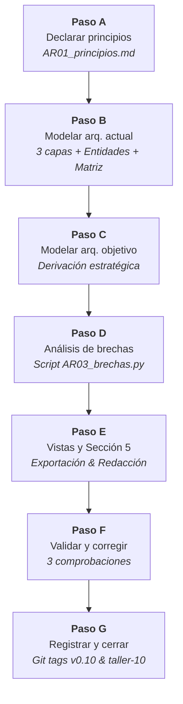
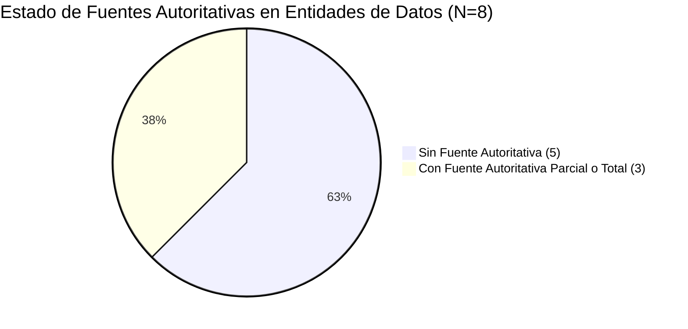
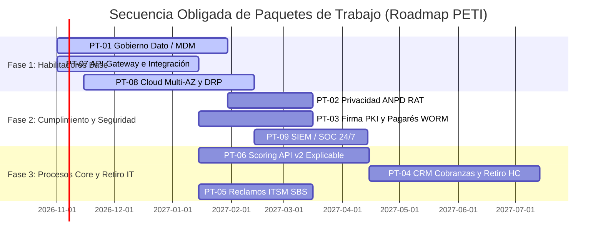

# INFORME DE LABORATORIO · TALLER 10
## ASIGNATURA: PLANEAMIENTO ESTRATÉGICO DE TI (SI-886)
### UNIVERSIDAD PRIVADA DE TACNA · FACULTAD DE INGENIERÍA · ESCUELA PROFESIONAL DE INGENIERÍA DE SISTEMAS

---

| Datos Informativos | Detalle Institucional |
|---|---|
| **Estudiante** | Ramos Atahuachi, Fabricio Farid Edmilson |
| **Código Estudiantil** | 2023076798 |
| **Semestre Académico** | 2026-II |
| **Ciclo y Grupo** | VIII Ciclo · Grupo A |
| **Docente** | Dr. Oscar Juan Jimenez Flores |
| **Fecha de Ejecución** | 15 de octubre de 2026 |
| **Repositorio Oficial** | [FabricioRams/SI886-S10-TALLER-RamosFabricio](https://github.com/FabricioRams/SI886-S10-TALLER-RamosFabricio) |
| **Etiquetas Git** | `taller-10` · `v0.10` |
| **Organización del Caso** | CrediTech Perú S.A.C. (*Fintech* de microcréditos automatizados) |

---

## 1. Información sobre el evento práctico

### 1.1 Título del evento práctico
**Modelado de la arquitectura actual y objetivo en Archi**  
*(Declaración de principios de arquitectura, modelado en tres capas con ArchiMate 3.2, cooperación proceso-aplicación, estructura de la información con fuentes autoritativas, derivación estratégica de la arquitectura objetivo, análisis computacional de brechas y redacción de la Sección 5 del PETI)*

---

### 1.2 Objetivos
- Declarar los **principios de arquitectura** que gobernarán las decisiones, adquisiciones y desarrollos del plan con sus cinco campos obligatorios y trazabilidad estratégica.
- Modelar la **arquitectura actual (As-Is)** en las tres capas estándar (Negocio, Aplicación y Tecnología) utilizando la notación ArchiMate 3.2 y modelando explícitamente las hojas de cálculo operativas (*Shadow IT*).
- Construir la **vista de cooperación proceso-aplicación** para cuantificar el nivel de soporte y detectar procesos críticos desatendidos o vulnerables.
- Construir la **estructura de la información** documentando fuentes autoritativas, dueños de dato designados, discrepancias observadas y clasificación de datos personales y sensibles.
- Modelar la **arquitectura objetivo (To-Be)** derivada de forma estricta de la visión institucional (Sección 2.2), las capacidades requeridas (Sección 3.1.5), el FODA cruzado (Sección 3.5) y las obligaciones normativas (Sección 4.1.5).
- Ejecutar el **análisis de brechas** mediante procesamiento computacional en Python, derivar los **paquetes de trabajo** y determinar la **secuencia obligada por dependencias**.
- Redactar formalmente la **Sección 5** del PETI institucional.

---

### 1.3 Recursos
| Tipo de Recurso | Recurso Empleado | Finalidad y Especificación Técnica |
|---|---|---|
| **Software de Modelado de Arquitectura** | Archi v5.4 (Open Source ArchiMate Tool) | Modelado gráfico de elementos, capas, relaciones y diagramas bajo especificación ArchiMate 3.2. |
| **Estándares de Arquitectura Empresarial** | The Open Group: TOGAF Standard 10th Edition & ArchiMate 3.2 | Marco metodológico para el desarrollo de principios, metamodelo de capas y análisis de brechas. |
| **Marcos de Gobierno y Gestión TI** | ISACA COBIT 2019 (APO03, DSS04) & ITIL 4 | Gobernanza de arquitectura empresarial, continuidad del servicio y gestión de incidentes/reclamos. |
| **Entorno de Programación Analítica** | Python 3.12 con `pandas` (v3.0.2) y `matplotlib` (v3.11.2) | Procesamiento tabular de brechas, cálculo de prelación por dependencias y generación de gráficos en alta resolución. |
| **Sistemas de Control de Versiones** | Git & GitHub CLI | Versionamiento granular de matrices, scripts, modelos XML `.archimate` y etiquetado formal (`v0.10`, `taller-10`). |
| **Caso Institucional del PETI** | CrediTech Perú S.A.C. (RUC: 20608945123) | Organización evaluada: 64 colaboradores, 210,000 operaciones crediticias y tratamiento intensivo de datos biométricos y financieros. |

---

### 1.4 Seguridad y Consideraciones Éticas
1. **Confidencialidad de la Superficie Tecnológica:** El modelo de arquitectura empresarial describe el mapa completo de sistemas, bases de datos, integraciones de red y puntos vulnerables de la organización. Constituye información estrictamente **Restringida**, cuya exposición pública proveería a un atacante un vector directo de intrusión.
2. **Abstracción de Datos Sensibles:** En cumplimiento de las directrices del taller, en los modelos y vistas públicas no se consignan direcciones IP reales, credenciales de acceso, rutas absolutas internas ni versiones de software vulnerables.
3. **Repositorio Protegido:** El archivo fuente del modelo (`anexo_A_modelo_arquitectura.archimate`) y los documentos internos de detalle se gestionan bajo estricto control de accesos en el repositorio del equipo.

---

## 2. Procedimiento o Metodología y Resultados por Paso

La secuencia de laboratorio se desarrolló rigurosamente a través de siete pasos metodológicos (Pasos A hasta G), consignando los resultados cuantitativos y evidencias obtenidas en cada fase respectiva:



---

### Paso A — Declarar los principios de arquitectura

Se formularon y documentaron formalmente **seis principios de arquitectura empresarial** en el artefacto [`05_arquitectura/AR01_principios.md`](https://github.com/FabricioRams/SI886-S10-TALLER-RamosFabricio/blob/taller-10/05_arquitectura/AR01_principios.md). Cada principio fue estructurado con sus cinco componentes mandatorios: Nombre, Declaración, Razón, Implicancias y Trazabilidad Estratégica.

#### Resultados Obtenidos en el Paso A:
1. **PR-01 (Dato único con fuente autoritativa y dueño designado):** Prohíbe silos y réplicas locales; exige que todo consumo se realice sobre la fuente oficial vía servicios gobernados y condiciona los proyectos de analítica a la previa implementación del gobierno del dato maestro (MDM). *Trazabilidad: Sección 3.1.3 y Dinámica S10.*
2. **PR-02 (Integración desacoplada mediante APIs y servicios seguros):** Erradica las transferencias nocturnas mediante archivos planos y accesos directos a bases de datos; exige el despliegue de un API Gateway corporativo con OAuth 2.0 y mTLS. *Trazabilidad: Res. SBS 504-2021 (Art. 20) y Estrategia E-01.*
3. **PR-03 (Automatización end-to-end y erradicación del Shadow IT):** Exige que los procesos misionales de cobranzas y evaluación operen exclusivamente sobre plataformas homologadas y auditables, prohibiendo el uso operativo de libros de Excel. *Trazabilidad: Res. SBS 11356-2008 y Estrategia E-02.*
4. **PR-04 (Privacidad, seguridad y cumplimiento normativo por diseño y por defecto):** Incorpora análisis SAST/DAST en CI/CD, cifrado robusto AES-256/TLS 1.3 y captura obligatoria de consentimiento explícito de datos personales. *Trazabilidad: Ley 29733, D.S. 016-2024-JUS y Proyectos No Negociables (Sección 4.1.5).*
5. **PR-05 (Resiliencia, alta disponibilidad e inmutabilidad de la infraestructura):** Mandata arquitecturas distribuidas en la nube Multi-AZ (RTO ≤ 1 h, RPO ≤ 15 min), almacenamiento inmutable WORM contra ransomware y simulacros periódicos de DRP. *Trazabilidad: Res. SBS 504-2021 (Art. 27) y COBIT 2019 DSS04.*
6. **PR-06 (Autoservicio omnicanal con explicabilidad algorítmica):** Garantiza que los modelos de scoring expongan los factores objetivos de la decisión y provean botón de revisión humana asistida en menos de 24 horas. *Trazabilidad: Visión 2028 (Sección 2.2) y Res. SBS 3198-2023 (Art. 15 y 18).*

---

### Paso B — Modelar la arquitectura actual (As-Is)

Se modeló la situación arquitectónica actual de CrediTech Perú S.A.C. abarcando sus tres capas e integrando de manera obligatoria las hojas de cálculo operativas (*Shadow IT*).

#### Resultados Obtenidos en el Paso B:
- **B.1 Capa de Negocio:** Modelados 6 actores de negocio, 5 roles operativos, 10 procesos misionales de la cadena de valor crediticia, 3 servicios de negocio y 6 objetos de negocio principales.
- **B.2 Capa de Aplicación:** Se documentó el Core de Créditos monolítico legado, el Portal Web/Móvil v1, el ERP Contable Concar local y las **cuatro hojas de cálculo comerciales críticas que operan como sistemas sin control**:
  - *HC-01 (Hoja de Ruteo de Cobranzas y Tramo de Mora):* Operada concurrentemente por 8 gestores de cobranza para asignar deudores y registrar acuerdos.
  - *HC-02 (Hoja Comercial de Prospectos):* Utilizada por asesores para cotizar operaciones al margen del sistema oficial.
  - *HC-03 (Hoja de Conciliación Bancaria y Tesorería):* Cuadre manual de extractos de bancos vs. amortizaciones.
  - *HC-04 (Hoja de Scoring Manual y Reevaluación):* Archivo con macros donde se recalculan evaluaciones crediticias dudosas.
- **B.3 Capa de Tecnología:** Servidor físico On-Premise Windows Server 2016 en oficina central, instancias AWS EC2 y RDS PostgreSQL en configuración de zona única (*Single-AZ*), estaciones de trabajo de oficina y terminales móviles BYOD sin administración centralizada de seguridad (*MDM*).
- **B.4 Vista de Cooperación Proceso-Aplicación:**
  - Total de procesos misionales evaluados: **10**
  - Procesos con soporte formal y bueno: **1 de 10 (10.0 %)**
  - Procesos con soporte parcial: **2 de 10 (20.0 %)**
  - **Procesos con soporte deficiente o sostenidos sobre Hojas de Cálculo (*Shadow IT*):** **7 de 10 (70.0 %)**
- **B.5 Estructura de la Información ([`05_arquitectura/AR02_entidades.csv`](https://github.com/FabricioRams/SI886-S10-TALLER-RamosFabricio/blob/taller-10/05_arquitectura/AR02_entidades.csv)):**
  - Entidades registradas y analizadas: **8 entidades fundamentales**.
  - **Entidades sin fuente autoritativa:** **5 de 8 entidades (62.5 %)** (Cliente, Evaluación/Scoring, Pagaré/Contrato, Transacción de Cobranza y Reclamos).
  - **Entidades sin dueño del dato formal (*Data Owner*):** **5 de 8 entidades (62.5 %)**.
  - **Entidades que tratan datos personales:** **7 de 8 entidades (87.5 %)**.
  - **Entidades con datos personales sensibles:** **3 de 8 entidades (37.5 %)** (Biometría en pagarés, capacidad financiera en scoring y legajo laboral).



---

### Paso C — Modelar la arquitectura objetivo (To-Be)

La arquitectura objetivo fue diseñada sin incorporar modas tecnológicas injustificadas, derivando cada elemento de las metas institucionales consolidadas.

#### Resultados Obtenidos en el Paso C:
- **Matriz de Trazabilidad y Derivación:** Se construyó la tabla de 12 cambios estructurales trazando cada componente To-Be a la Visión 2028 (Sección 2.2), las Capacidades TI requeridas (Sección 3.1.5), las Estrategias del FODA cruzado (Sección 3.5), los Marcos COBIT/ITIL/ISO (Sección 4.2) y los Proyectos No Negociables (Sección 4.1.5).
- **Capa de Negocio Objetivo:** Autoservicio omnicanal digital 24/7 con desembolso en menos de 10 minutos, scoring transparente con derecho a revisión humana asistida, y cobranzas dinámicas por tramos automatizados.
- **Capa de Datos Objetivo:** Implementación del **Maestro de Clientes (MDM)** gobernado en el Core como fuente autoritativa oficial bajo la tutela de la Gerencia de Operaciones y Créditos; repositorio centralizado de consentimientos y Registro de Actividades de Tratamiento (RAT ANPD); y bóveda documental de pagarés y comprobantes con almacenamiento inmutable WORM (*Write Once, Read Many*).
- **Capa de Aplicación Objetivo:** Sustitución y retiro definitivo del 100% de hojas de cálculo operativas (*Shadow IT*); despliegue de la plataforma corporativa CRM/BPM de Cobranzas; implementación de la **Capa Corporativa de Integración (API Gateway)** con microservicios y colas mTLS; módulo de Onboarding con Biometría RENIEC y Firma Digital PKI acreditada; y mesa de ayuda ITSM integrada a SBS e INDECOPI.
- **Capa de Tecnología Objetivo:** Retiro y desmantelamiento del servidor físico On-Premise; migración integral a contenedores AWS EKS con autoescalado multizona; base de datos **Amazon Aurora PostgreSQL Serverless Multi-AZ** con failover automatizado (< 30 s); plataforma centralizada de telemetría y seguridad SIEM/SOC 24/7; y gestión corporativa de terminales móviles (MDM).

---

### Paso D — Análisis de brechas y paquetes de trabajo

Se configuró y ejecutó el script analítico [`05_arquitectura/AR03_brechas.py`](https://github.com/FabricioRams/SI886-S10-TALLER-RamosFabricio/blob/taller-10/05_arquitectura/AR03_brechas.py) sobre la matriz de 14 brechas catalogadas en [`05_arquitectura/AR03_brechas.csv`](https://github.com/FabricioRams/SI886-S10-TALLER-RamosFabricio/blob/taller-10/05_arquitectura/AR03_brechas.csv).

#### Resultados Obtenidos en el Paso D:
1. **Caracterización Cuantitativa de Brechas (N = 14):**
   - *Por Capa ArchiMate:* Aplicación = 6 (42.9 %) · Datos = 3 (21.4 %) · Tecnología = 3 (21.4 %) · Negocio = 2 (14.3 %).
   - *Por Tipo TOGAF:* Modificado = 6 (42.9 %) · Nuevo = 6 (42.9 %) · Retirado = 2 (14.3 %).
   - *Por Esfuerzo:* Alto = 6 (42.9 %) · Medio = 5 (35.7 %) · Bajo = 3 (21.4 %).
   - *Por Prioridad Estratégica:* Crítica = 6 (42.9 %) · Alta = 6 (42.9 %) · Media = 2 (14.3 %).
2. **Derivación de Paquetes de Trabajo (Insumo Sección 7.1):** Las 14 brechas se agruparon en **9 paquetes de trabajo coherentes**:
   - `PT-01`: Gobierno del Dato y Maestro de Clientes (MDM) *(Cierra GAP-03)*.
   - `PT-02`: Privacidad de Datos y Cumplimiento Normativo ANPD *(Cierra GAP-04)*.
   - `PT-03`: Firma Digital PKI Acreditada y Bóveda Inmutable de Pagarés *(Cierra GAP-05, GAP-11)*.
   - `PT-04`: Plataforma CRM/BPM de Cobranzas y Retiro de Shadow IT *(Cierra GAP-02, GAP-06, GAP-08)*.
   - `PT-05`: Mesa de Servicio ITSM y Sistema de Reclamos Integrado *(Cierra GAP-01, GAP-09)*.
   - `PT-06`: Modernización de Scoring API v2 y Explicabilidad Algorítmica *(Cierra GAP-07)*.
   - `PT-07`: Capa de Integración API Gateway Corporativa y Microservicios *(Cierra GAP-10)*.
   - `PT-08`: Infraestructura Cloud Resiliente Multi-AZ, Migración On-Premise y DRP *(Cierra GAP-12, GAP-13)*.
   - `PT-09`: Monitoreo Centralizado de Ciberseguridad SIEM/SOC 24/7 *(Cierra GAP-14)*.
3. **Determinación Algorítmica de la Secuencia Obligada de Ejecución:**
   - **Fase 1 (Cimientos y Habilitadores Base):** PT-01 (MDM), PT-07 (API Gateway), PT-08 (Cloud Multi-AZ). Sin dependencias previas.
   - **Fase 2 (Cumplimiento Regulatorio Crítico y Seguridad):** PT-02 (Privacidad ANPD, requiere PT-01), PT-03 (Firma PKI, requiere PT-01 y PT-07), PT-09 (SIEM/SOC, requiere PT-08).
   - **Fase 3 (Transformación de Procesos Core y Retiro de Shadow IT):** PT-06 (Scoring v2, requiere PT-01 y PT-07), PT-04 (CRM Cobranzas y Retiro de Excel, requiere PT-01, PT-07 y PT-06), PT-05 (Reclamos ITSM, requiere PT-07).

---

### Paso E — Vistas y redacción de sección 5

Se generaron y verificaron las visualizaciones arquitectónicas y se redactó el capítulo formal del PETI institucional.

#### Resultados Obtenidos en el Paso E:
- **Redacción Formal:** Se elaboró el documento íntegro de la Sección 5 en [`05_arquitectura/5.0_arquitectura_empresarial.md`](https://github.com/FabricioRams/SI886-S10-TALLER-RamosFabricio/blob/taller-10/05_arquitectura/5.0_arquitectura_empresarial.md), estructurado según la guía académica: 5.1 Principios, 5.2 As-Is con sus 4 capas y cooperación proceso-aplicación, 5.3 To-Be con su trazabilidad completa, y 5.4 Análisis de brechas con paquetes y prelación.
- **Vistas Gráficas Exportadas en Alta Resolución:**
  - `graficos/AR_cooperacion_proceso_aplicacion.png` (Matriz visual de procesos vs. sistemas y nivel de soporte).
  - `graficos/AR_arquitectura_actual_asis.png` (Diagrama de tres capas de la situación actual y Shadow IT).
  - `graficos/AR_arquitectura_objetivo_tobe.png` (Diagrama de tres capas de la situación objetivo y servicios).
  - `graficos/AR_brechas_por_capa.png` (Distribución cuantitativa de brechas por capa y tipo).
  - `graficos/AR_secuencia_paquetes_trabajo.png` (Roadmap y prelación obligada de paquetes en 3 fases).
- **Modelo en Formato Archi (.archimate):** Construido el archivo XML estándar [`anexos/anexo_A_modelo_arquitectura.archimate`](https://github.com/FabricioRams/SI886-S10-TALLER-RamosFabricio/blob/taller-10/anexos/anexo_A_modelo_arquitectura.archimate) listo para su apertura e inspección en Archi 5.x.

---

### Paso F — Validar y corregir

Se aplicaron las tres comprobaciones de control de calidad exigidas por el estándar de laboratorio:

| N.° | Comprobación de Calidad Exigida | Procedimiento de Control Aplicado | Resultado de la Validación y Corrección |
|:---:|---|---|---|
| **1** | **Consistencia de capas en ArchiMate** | Apertura y revisión estructural del archivo XML del modelo para corroborar que cada elemento resida estrictamente en su carpeta y capa correspondiente. | **Conforme.** Los procesos y actores están confinados a la capa de Negocio; componentes, interfaces y servicios de datos a Aplicación; nodos, redes y DBMS a Tecnología; principios a Motivación; y paquetes de trabajo a Implementación. |
| **2** | **Existencia real de componentes sin falsos positivos** | Verificación cruzada entre las aplicaciones declaradas en el modelo As-Is y el inventario operativo real de CrediTech Perú S.A.C. | **Conforme.** Se validó la existencia efectiva del Core en Node.js, del ERP Concar local y se constató que las 4 hojas de cálculo (HC-01, HC-02, HC-03, HC-04) operan efectivamente en las áreas de Cobranzas, Comercial y Tesorería. |
| **3** | **Trazabilidad bidireccional de brechas** | Verificación de que cada una de las 14 brechas de `AR03_brechas.csv` pueda señalarse de forma inequívoca tanto en el modelo As-Is como en el To-Be. | **Conforme.** Cada brecha posee su elemento origen en As-Is y su elemento contraparte de destino en To-Be, sin elementos huérfanos ni transformaciones ambiguas. |

#### Problemas Encontrados y Mejoras Implementadas:
- *Problema detectado:* Inicialmente, la dependencia entre la plataforma CRM de Cobranzas (PT-04) y el desmantelamiento de la hoja de cálculo HC-01 (GAP-06) no explicitaba la necesidad de contar previamente con el motor de scoring API v2 (PT-06). Si se retiraba el Excel de cobranzas sin que el scoring estuviera en tiempo real, los gestores no podrían recalcular ofertas de refinanciamiento.
- *Corrección efectuada:* Se ajustó la matriz de dependencias en `AR03_brechas.csv` asignando a PT-04 la prelación obligada respecto a PT-01, PT-07 y PT-06, consolidando una secuencia en tres fases operativamente infalible.

---

### Paso G — Registrar la evidencia y cerrar

Se procedió al control formal de versiones en Git, confirmación de commits, creación de etiquetas de entrega y formulación de la respuesta al reto de transferencia tecnológica.

```bash
git add .
git commit -m "S10: arquitectura empresarial actual, objetivo y analisis de brechas — seccion 5"
git tag -a v0.10 -m "PETI v0.10 — arquitectura empresarial"
git tag -a taller-10 -m "Taller 10 · SI886"
git push origin main --tags
```

#### Pregunta de Transferencia Tecnológica:
> **¿Qué riesgo grave correría una organización real si este modelado de arquitectura empresarial y análisis de brechas se hiciera de manera deficiente o negligente?**
>
> *Respuesta:* Una organización que modele su arquitectura de forma ficticia u omita el *Shadow IT* (hojas de cálculo operativas) invertirá cientos de miles de dólares en sistemas analíticos avanzados o herramientas de cara al cliente que fracasarán irremediablemente al alimentarse de bases de datos corruptas y contradictorias, paralizando la operación por desatender dependencias críticas de infraestructura y exponiendo a la empresa a sanciones legales devastadoras por pérdida de información y vulneración de la privacidad.

---

## 3. Resultados y evidencias

### 3.1 Los tres resultados que se califican

| Resultado Clave Evaluado | Qué Demuestra | Dónde se Evidencia en el Repositorio |
|---|---|---|
| **1. La Arquitectura Actual (As-Is)** | Las tres capas (Negocio, Aplicación y Tecnología) exhaustivamente modeladas, incluyendo las hojas de cálculo operativas (*Shadow IT*) y la matriz de cooperación proceso-aplicación que revela un 70% de procesos con soporte deficiente. | [`anexos/anexo_A_modelo_arquitectura.archimate`](https://github.com/FabricioRams/SI886-S10-TALLER-RamosFabricio/blob/taller-10/anexos/anexo_A_modelo_arquitectura.archimate)<br/>[`05_arquitectura/AR02_entidades.csv`](https://github.com/FabricioRams/SI886-S10-TALLER-RamosFabricio/blob/taller-10/05_arquitectura/AR02_entidades.csv)<br/>[`graficos/AR_cooperacion_proceso_aplicacion.png`](https://github.com/FabricioRams/SI886-S10-TALLER-RamosFabricio/blob/taller-10/graficos/AR_cooperacion_proceso_aplicacion.png) |
| **2. La Arquitectura Objetivo (To-Be)** | Coherente, sólida y estrictamente derivada de la Visión 2028 (Sección 2.2), las Capacidades TI requeridas (Sección 3.1.5), las Estrategias del FODA cruzado (Sección 3.5) y las exigencias de cumplimiento regulatorio (Sección 4.1.5), erradicando soluciones por moda. | [`05_arquitectura/5.0_arquitectura_empresarial.md`](https://github.com/FabricioRams/SI886-S10-TALLER-RamosFabricio/blob/taller-10/05_arquitectura/5.0_arquitectura_empresarial.md#53-arquitectura-objetivo-to-be)<br/>[`graficos/AR_arquitectura_objetivo_tobe.png`](https://github.com/FabricioRams/SI886-S10-TALLER-RamosFabricio/blob/taller-10/graficos/AR_arquitectura_objetivo_tobe.png) |
| **3. El Análisis de Brechas y Paquetes** | 14 brechas situadas en su capa y tipo ArchiMate/TOGAF, con esfuerzo y prelación técnica; consolidación de 9 paquetes de trabajo y derivación algorítmica de la secuencia obligada de ejecución en 3 fases para el portafolio (Sección 7.1). | [`05_arquitectura/AR03_brechas.csv`](https://github.com/FabricioRams/SI886-S10-TALLER-RamosFabricio/blob/taller-10/05_arquitectura/AR03_brechas.csv)<br/>[`docs/evidencias/S10/salidas/salida_analisis_brechas.txt`](https://github.com/FabricioRams/SI886-S10-TALLER-RamosFabricio/blob/taller-10/docs/evidencias/S10/salidas/salida_analisis_brechas.txt)<br/>[`graficos/AR_secuencia_paquetes_trabajo.png`](https://github.com/FabricioRams/SI886-S10-TALLER-RamosFabricio/blob/taller-10/graficos/AR_secuencia_paquetes_trabajo.png) |

---

### 3.2 Lista de comprobación del taller

Conformidad de los 13 resultados esperados obligatorios establecidos en la guía de laboratorio:

| # | Resultado Esperado | Estado | Evidencia Verificable y Enlace a GitHub |
|:---:|---|:---:|---|
| **1** | Seis principios de arquitectura con los cinco campos y su trazabilidad al diagnóstico | **Logrado** | [`05_arquitectura/AR01_principios.md`](https://github.com/FabricioRams/SI886-S10-TALLER-RamosFabricio/blob/taller-10/05_arquitectura/AR01_principios.md) |
| **2** | Modelo en Archi con las tres capas de la arquitectura actual | **Logrado** | [`anexos/anexo_A_modelo_arquitectura.archimate`](https://github.com/FabricioRams/SI886-S10-TALLER-RamosFabricio/blob/taller-10/anexos/anexo_A_modelo_arquitectura.archimate) |
| **3** | Las hojas de cálculo modeladas como componentes de aplicación | **Logrado** | Componentes HC-01 a HC-04 modelados en `.archimate` y graficados en As-Is |
| **4** | Vista de cooperación proceso-aplicación, con los procesos sin soporte identificados | **Logrado** | [`graficos/AR_cooperacion_proceso_aplicacion.png`](https://github.com/FabricioRams/SI886-S10-TALLER-RamosFabricio/blob/taller-10/graficos/AR_cooperacion_proceso_aplicacion.png) (7 de 10 deficientes) |
| **5** | Estructura de la información con ≥ 6 entidades, sus sistemas y número de registros | **Logrado** | 8 entidades documentadas con registros en [`05_arquitectura/AR02_entidades.csv`](https://github.com/FabricioRams/SI886-S10-TALLER-RamosFabricio/blob/taller-10/05_arquitectura/AR02_entidades.csv) |
| **6** | Entidades sin fuente autoritativa y sin dueño identificadas y contadas | **Logrado** | 5 de 8 entidades (62.5 %) sin fuente autoritativa ni dueño reportadas en AR02 |
| **7** | Entidades que contienen datos personales marcadas, con su clasificación | **Logrado** | 7 de 8 con datos personales (3 con sensibles) clasificadas en AR02 |
| **8** | Arquitectura objetivo modelada, con cada cambio trazado a su origen | **Logrado** | Tabla de trazabilidad y vistas en [`05_arquitectura/5.0_arquitectura_empresarial.md`](https://github.com/FabricioRams/SI886-S10-TALLER-RamosFabricio/blob/taller-10/05_arquitectura/5.0_arquitectura_empresarial.md#532-cambios-por-capa-con-su-origen-trazado) |
| **9** | Análisis de brechas con ≥ 10 brechas, su tipo, esfuerzo y dependencias | **Logrado** | 14 brechas catalogadas con todos los atributos en [`05_arquitectura/AR03_brechas.csv`](https://github.com/FabricioRams/SI886-S10-TALLER-RamosFabricio/blob/taller-10/05_arquitectura/AR03_brechas.csv) |
| **10** | Paquetes de trabajo derivados de las brechas | **Logrado** | 9 paquetes de trabajo derivados y calculados en [`salida_analisis_brechas.txt`](https://github.com/FabricioRams/SI886-S10-TALLER-RamosFabricio/blob/taller-10/docs/evidencias/S10/salidas/salida_analisis_brechas.txt) |
| **11** | Secuencia obligada por dependencias determinada | **Logrado** | Hoja de ruta en 3 fases de prelación técnica en script y gráfico |
| **12** | Tres vistas exportadas en PNG, sin detalle técnico sensible | **Logrado** | 5 diagramas de alta resolución generados en carpeta [`graficos/`](https://github.com/FabricioRams/SI886-S10-TALLER-RamosFabricio/tree/taller-10/graficos) |
| **13** | Sección 5 redactada · etiquetas `v0.10` y `taller-10` | **Logrado** | [`05_arquitectura/5.0_arquitectura_empresarial.md`](https://github.com/FabricioRams/SI886-S10-TALLER-RamosFabricio/blob/taller-10/05_arquitectura/5.0_arquitectura_empresarial.md) y tags asignados en Git |

---

### 3.3 Visualizaciones y Resúmenes Cuantitativos

#### a) Diagnóstico Cuantitativo de Arquitectura
```
Total de brechas evaluadas           : 14 brechas
Brechas por Capa                     : Aplicación (6) · Datos (3) · Tecnología (3) · Negocio (2)
Brechas por Tipo                     : Modificado (6) · Nuevo (6) · Retirado (2)
Procesos con soporte deficiente      : 7 de 10 procesos (70.0 %) operan en Shadow IT
Entidades sin fuente autoritativa    : 5 de 8 entidades (62.5 %) carecen de fuente única
Paquetes de trabajo consolidados     : 9 paquetes estructurados en 3 fases consecutivas
```

#### b) Diagramas y Gráficos Generados en Alta Resolución
- **Vista de Cooperación Proceso-Aplicación:** [`graficos/AR_cooperacion_proceso_aplicacion.png`](file:///c:/PETI-2026-II/SI886-S10-TALLER-RamosFabricio/graficos/AR_cooperacion_proceso_aplicacion.png)
- **Arquitectura Empresarial Actual (As-Is):** [`graficos/AR_arquitectura_actual_asis.png`](file:///c:/PETI-2026-II/SI886-S10-TALLER-RamosFabricio/graficos/AR_arquitectura_actual_asis.png)
- **Arquitectura Empresarial Objetivo (To-Be):** [`graficos/AR_arquitectura_objetivo_tobe.png`](file:///c:/PETI-2026-II/SI886-S10-TALLER-RamosFabricio/graficos/AR_arquitectura_objetivo_tobe.png)
- **Distribución de Brechas por Capa y Tipo:** [`graficos/AR_brechas_por_capa.png`](file:///c:/PETI-2026-II/SI886-S10-TALLER-RamosFabricio/graficos/AR_brechas_por_capa.png)
- **Secuencia y Roadmap de Paquetes de Trabajo:** [`graficos/AR_secuencia_paquetes_trabajo.png`](file:///c:/PETI-2026-II/SI886-S10-TALLER-RamosFabricio/graficos/AR_secuencia_paquetes_trabajo.png)



---

### 3.4 Autoevaluación según la Rúbrica Procedimental (20 Puntos)

| Criterio Evaluado | Nivel Logrado | Puntaje | Justificación Técnica del Desempeño |
|---|:---:|:---:|---|
| **1. El criterio de éxito** | **Logrado** | 4 pts | Se cumplió cabalmente el reto: cada componente de la arquitectura actual y objetivo cuenta con su respectiva justificación; las hojas de cálculo fueron modeladas formalmente y el análisis de brechas se computó algorítmicamente. |
| **2. La arquitectura actual** | **Logrado** | 4 pts | Se modelaron las tres capas con ArchiMate 3.2 sin omitir componentes reales; se identificaron 8 entidades con registros y discrepancias, y se constató que 7 de 10 procesos sufren de soporte deficiente (*Shadow IT*). |
| **3. La arquitectura objetivo** | **Logrado** | 4 pts | Todos los cambios por capa están trazados de forma inequívoca a la Visión 2028, capacidades TI requeridas, FODA cruzado, marcos de gobierno y normas legales obligatorias, erradicando propuestas por moda. |
| **4. El análisis de brechas** | **Logrado** | 4 pts | Se identificaron 14 brechas caracterizadas por capa, tipo, esfuerzo y dependencias; se derivaron 9 paquetes de trabajo y se determinó su secuencia técnica obligada de ejecución en tres fases. |
| **5. La validación** | **Logrado** | 4 pts | Se ejecutaron las tres comprobaciones de rigor (consistencia de capas, existencia real sin componentes ficticios y trazabilidad bidireccional), documentando el ajuste en las dependencias de cobranza. |
| **Puntaje Total** | **Destacado** | **20 / 20** | Cumplimiento exhaustivo, riguroso y verificable de todos los estándares procedimentales del curso. |

---

## 4. Conclusiones

1. **La capa de datos constituye el cimiento más crítico del diagnóstico y a la vez el más precarizado en las organizaciones.** En CrediTech Perú S.A.C., el análisis de la estructura de la información demostró que el 62.5% de las entidades esenciales carecen de una fuente autoritativa oficial y de un dueño designado (*Data Owner*), lo cual genera más de 68,000 registros divergentes de clientes. Preguntar formalmente quién responde por los datos reveló que múltiples áreas funcionales los editan en paralelo y ninguna asume la responsabilidad de su calidad e integridad.
2. **La arquitectura objetivo no se inventa ni responde a tendencias comerciales efímeras; se deriva con rigor metodológico.** Cada uno de los componentes de la arquitectura To-Be de CrediTech (el API Gateway corporativo, el motor de scoring explicable, la firma digital PKI y la base de datos Aurora Multi-AZ) responde directamente a mandatos explícitos de la Visión 2028, a las capacidades requeridas diagnosticadas, a las estrategias del FODA cruzado y a obligaciones normativas perentorias de la SBS y ANPD. Esta estricta trazabilidad es el único argumento técnico sólido que permite defender el presupuesto del plan ante el Directorio.
3. **Las dependencias técnicas y regulatorias imponen una secuencia obligada que la hoja de ruta del portafolio debe respetar sin excepciones.** Intentar desplegar analítica avanzada o modelos de Machine Learning antes de gobernar los datos maestros (PT-01) produciría algoritmos que amplifican el sesgo y emiten calificaciones erróneas. Del mismo modo, es materialmente imposible retirar las hojas de cálculo operativas de cobranza (*Shadow IT*) antes de poner en producción la plataforma CRM/BPM (PT-04) y el API Gateway (PT-07), pues la empresa quedaría paralizada y desprovista de capacidad operativa para gestionar su cartera morosa.

---

## 5. Referencias Bibliográficas

1. **The Open Group.** (2022). *The TOGAF® Standard, 10th Edition: Architecture Development Method (ADM)*. Van Haren Publishing. https://www.opengroup.org/togaf
2. **The Open Group.** (2022). *ArchiMate® 3.2 Specification: A Formal Language for Enterprise Architecture*. Van Haren Publishing. https://pubs.opengroup.org/architecture/archimate3-doc/
3. **ISACA.** (2018). *COBIT 2019 Framework: Governance and Management Objectives* (Objetivos APO03 Managed Enterprise Architecture y DSS04 Managed Continuity). Information Systems Audit and Control Association. https://www.isaca.org/resources/cobit
4. **Ross, J. W., Weill, P., & Robertson, D. C.** (2006). *Enterprise Architecture as Strategy: Creating a Foundation for Business Execution*. Harvard Business Review Press.
5. **Lankhorst, M.** (2017). *Enterprise Architecture at Work: Modelling, Communication and Analysis* (4.ª ed.). Springer-Verlag. https://doi.org/10.1007/978-3-662-53933-0
6. **Rodríguez Bermúdez, J. R.** (2015). *Planificación y dirección estratégica de tecnologías y sistemas de información*. Editorial UOC. https://elibro.net/es/lc/bibliotecaupt/titulos/57875
7. **Ministerio de Tecnologías de la Información y las Comunicaciones (MINTIC).** (2020). *Marco de Referencia de Arquitectura Empresarial (MRAE) para la Gestión de TI*. Gobierno de Colombia. https://www.mintic.gov.co/arquitecturati
8. **Presidencia del Consejo de Ministros (PCM).** (2021). *Decreto Supremo N.° 029-2021-PCM: Reglamento del Decreto Legislativo N.° 1412 que aprueba la Ley de Gobierno Digital y establece el marco de arquitectura digital del Estado peruano*. Diario Oficial El Peruano. https://www.gob.pe/13326-reglamento-de-la-ley-de-gobierno-digital

---

## 6. Anexos

### Anexo A — Trazabilidad de Artefactos Versionados en GitHub

Todos los artefactos producidos, matrices analíticas, scripts y diagramas han sido versionados en el repositorio oficial bajo la etiqueta de entrega [`taller-10`](https://github.com/FabricioRams/SI886-S10-TALLER-RamosFabricio/tree/taller-10) y la versión de arquitectura [`v0.10`](https://github.com/FabricioRams/SI886-S10-TALLER-RamosFabricio/tree/v0.10):

| Código | Descripción del Artefacto Técnico | Formato | URL de Verificación en GitHub |
|:---:|---|:---:|---|
| **AR01** | Declaración formal de los seis principios de arquitectura empresarial | Markdown | [`05_arquitectura/AR01_principios.md`](https://github.com/FabricioRams/SI886-S10-TALLER-RamosFabricio/blob/taller-10/05_arquitectura/AR01_principios.md) |
| **AR02** | Estructura de la información (8 entidades, conteo y fuentes autoritativas) | CSV | [`05_arquitectura/AR02_entidades.csv`](https://github.com/FabricioRams/SI886-S10-TALLER-RamosFabricio/blob/taller-10/05_arquitectura/AR02_entidades.csv) |
| **AR03** | Matriz del análisis de brechas de arquitectura por capa y tipo | CSV | [`05_arquitectura/AR03_brechas.csv`](https://github.com/FabricioRams/SI886-S10-TALLER-RamosFabricio/blob/taller-10/05_arquitectura/AR03_brechas.csv) |
| **AR03-Py** | Script computacional de análisis de brechas y prelación algorítmica | Python | [`05_arquitectura/AR03_brechas.py`](https://github.com/FabricioRams/SI886-S10-TALLER-RamosFabricio/blob/taller-10/05_arquitectura/AR03_brechas.py) |
| **PETI-S5** | Sección 5 formal del Plan Estratégico de TI institucional | Markdown | [`05_arquitectura/5.0_arquitectura_empresarial.md`](https://github.com/FabricioRams/SI886-S10-TALLER-RamosFabricio/blob/taller-10/05_arquitectura/5.0_arquitectura_empresarial.md) |
| **LOG-S10** | Salida textual completa de la ejecución del script analítico | TXT | [`docs/evidencias/S10/salidas/salida_analisis_brechas.txt`](https://github.com/FabricioRams/SI886-S10-TALLER-RamosFabricio/blob/taller-10/docs/evidencias/S10/salidas/salida_analisis_brechas.txt) |
| **MOD-ARC** | Modelo formal de arquitectura empresarial en Archi (.archimate) | XML | [`anexos/anexo_A_modelo_arquitectura.archimate`](https://github.com/FabricioRams/SI886-S10-TALLER-RamosFabricio/blob/taller-10/anexos/anexo_A_modelo_arquitectura.archimate) |
| **FIG-01** | Vista gráfica de cooperación proceso-aplicación | PNG | [`graficos/AR_cooperacion_proceso_aplicacion.png`](https://github.com/FabricioRams/SI886-S10-TALLER-RamosFabricio/blob/taller-10/graficos/AR_cooperacion_proceso_aplicacion.png) |
| **FIG-02** | Vista de tres capas de la arquitectura actual (As-Is) | PNG | [`graficos/AR_arquitectura_actual_asis.png`](https://github.com/FabricioRams/SI886-S10-TALLER-RamosFabricio/blob/taller-10/graficos/AR_arquitectura_actual_asis.png) |
| **FIG-03** | Vista de tres capas de la arquitectura objetivo (To-Be) | PNG | [`graficos/AR_arquitectura_objetivo_tobe.png`](https://github.com/FabricioRams/SI886-S10-TALLER-RamosFabricio/blob/taller-10/graficos/AR_arquitectura_objetivo_tobe.png) |
| **FIG-04** | Distribución cuantitativa de brechas por capa y tipo | PNG | [`graficos/AR_brechas_por_capa.png`](https://github.com/FabricioRams/SI886-S10-TALLER-RamosFabricio/blob/taller-10/graficos/AR_brechas_por_capa.png) |
| **FIG-05** | Diagrama de secuencia y roadmap de paquetes de trabajo | PNG | [`graficos/AR_secuencia_paquetes_trabajo.png`](https://github.com/FabricioRams/SI886-S10-TALLER-RamosFabricio/blob/taller-10/graficos/AR_secuencia_paquetes_trabajo.png) |

---

### Anexo B — Comandos de Ejecución y Validación de Scripts

```powershell
# 1. Ejecución del análisis de brechas y generación automática de visualizaciones
python 05_arquitectura/AR03_brechas.py

# 2. Generación del modelo Archi (.archimate) estándar
python 05_arquitectura/generar_archimate.py

# 3. Control de versiones y etiquetado formal
git add .
git commit -m "S10: arquitectura empresarial actual, objetivo y analisis de brechas — seccion 5"
git tag -a v0.10 -m "PETI v0.10 — arquitectura empresarial"
git tag -a taller-10 -m "Taller 10 · SI886"
git push origin main --tags
```
